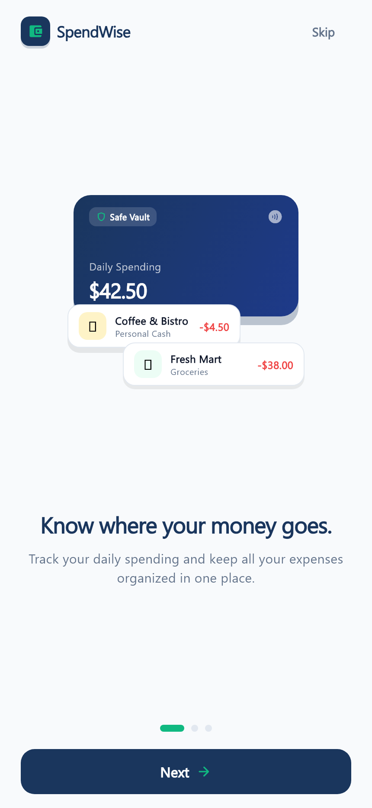
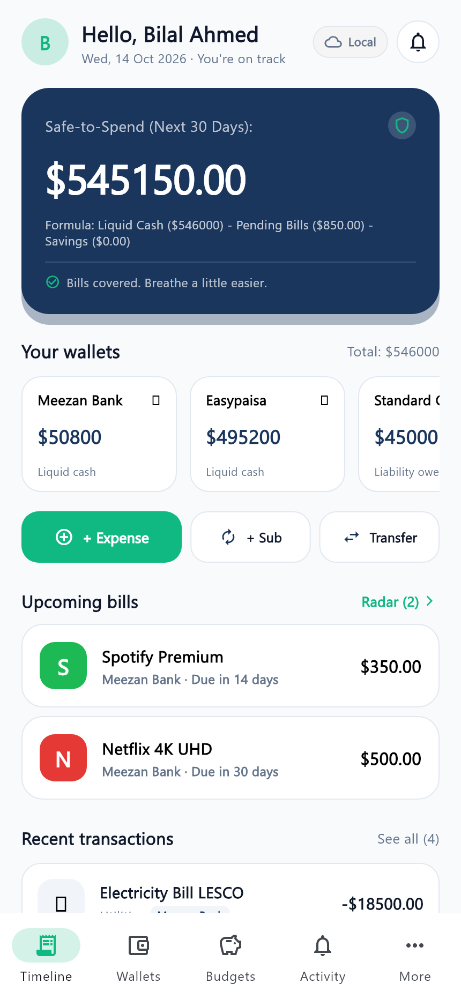
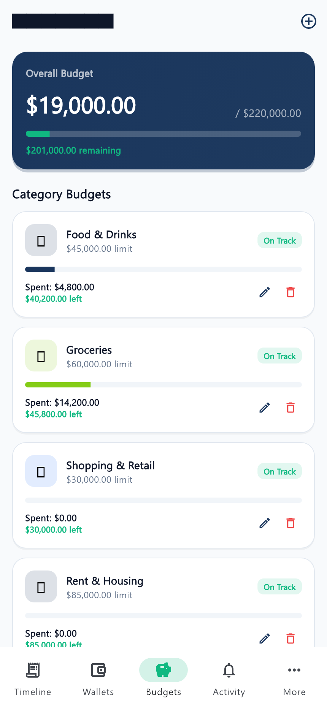
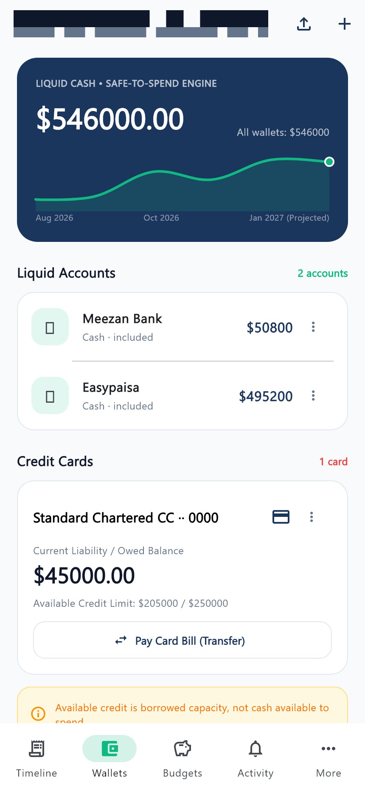
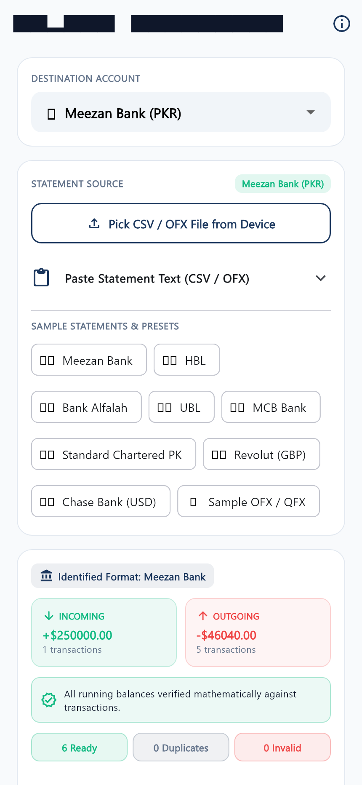
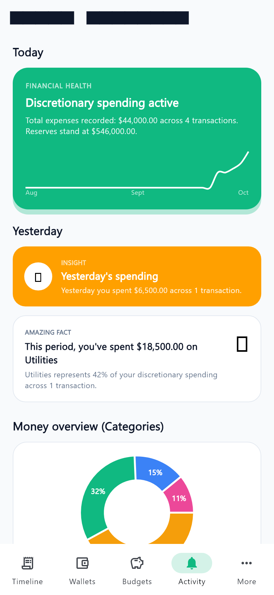
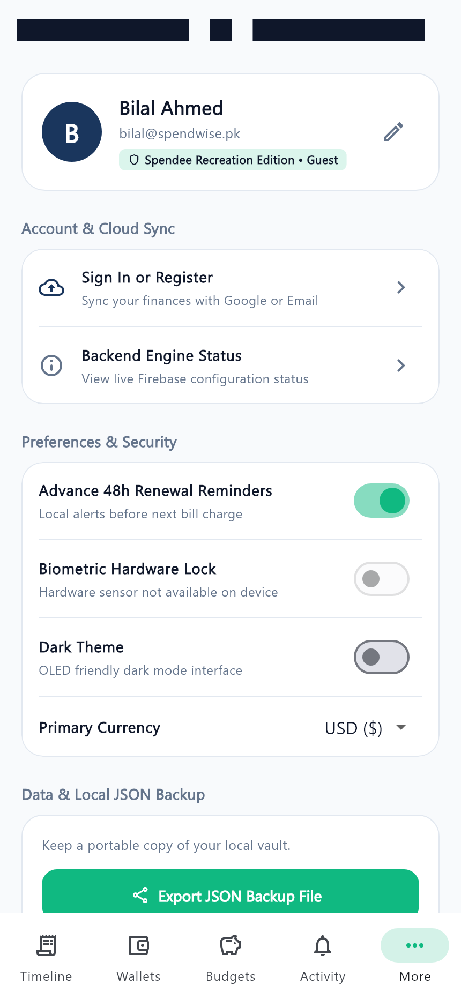

# SpendWise — Smart Budgeting & Subscription Hub 💳📊

[](https://flutter.dev)
[](https://dart.dev)
[](https://m3.material.io)
[](https://www.android.com)
[](https://github.com/bilal-asif-devops/SpendWise)
[](https://opensource.org/licenses/MIT)

**SpendWise** is a personal finance companion and recurring subscription radar designed specifically for Android. Built with Flutter, it eliminates common financial blind spots through a dynamic **Safe-to-Spend mathematical engine**, interactive **category-level budgeting**, strict **asset vs liability ledger isolation**, and an automated **Pakistani commercial bank statement ingestion engine** (supporting Meezan Bank, HBL, Bank Alfalah, and UBL).

---

## 🌟 Key Innovations & Architecture

```
┌────────────────────────────────────────────────────────────────────────┐
│                        LIVE SAFE-TO-SPEND ENGINE                       │
│                                                                        │
│   ┌──────────────┐     ┌──────────────┐     ┌──────────────┐          │
│   │  Liquid Cash │  -  │Pending Bills │  -  │Savings Target│  =  Rs.  │
│   │ (Bank/Wallets)│     │(Subscriptions)│    │(Discretionary)│   SAFE   │
│   └──────────────┘     └──────────────┘     └──────────────┘          │
└────────────────────────────────────────────────────────────────────────┘
```

1. **Live Mathematical Safe-to-Spend Dynamic Hero Card**
   - Eliminates deceptive gross balances by computing: `Safe-to-Spend = Liquid Cash - Pending Fixed Bills - Target Savings`.
   - Never counts borrowed credit card limits as spendable cash.

2. **Interactive Category Budgets & Spending Horizon**
   - Full CRUD support for real expense categories (Food & Drinks, Groceries, Shopping, Rent & Housing).
   - Real-time progress bars, on-track indicators, and overspending alerts.
   - Prevents duplicate active budgets for identical categories and billing cycles.

3. **Strict Asset vs Liability Ledger Separation**
   - Explicitly segregates unencumbered Liquid Cash (Meezan Bank, Easypaisa) from revolving Credit Card liabilities (Standard Chartered Titanium).
   - Real-time credit limit utilization progress bar with borrowing warnings.
   - Dedicated "Pay Card Bill" liability settlement workflow.

4. **Pakistani Commercial Banking Statement Importer**
   - Built-in ingestion presets for Meezan Bank, Habib Bank Limited (HBL), Bank Alfalah, and United Bank Limited (UBL).
   - Running mathematical balance reconciliation verifying opening vs closing totals.
   - Direction-based transaction recording (Incoming $\rightarrow$ Income, Outgoing $\rightarrow$ Expense) with resilient uncategorized fallbacks.

5. **Local-First Privacy & Hardware Biometric Security**
   - 100% functional offline without requiring banking logins or third-party credential aggregators.
   - Android hardware fingerprint/face lock integration with system picker pause immunity.
   - Local JSON Vault with one-tap encrypted backup and restore via native Android Share Sheet.
   - Real-time Firebase Cloud Synchronization for authenticated users.

---

## 📱 Application Screen Gallery

| 1. Dynamic Onboarding & Auth | 2. Home Dashboard (Safe-to-Spend) | 3. Interactive Category Budgets |
| :---: | :---: | :---: |
|  |  |  |
| *Streamlined Android auth without Apple sign-in* | *Live mathematical Safe-to-Spend hero card* | *Category-level budgets & spending horizon* |

| 4. Wallets & Credit Ledger | 5. Bank Statement Importer | 6. Activity Insights & Donut Mix |
| :---: | :---: | :---: |
|  |  |  |
| *Strict asset vs liability debt segregation* | *Pakistani commercial banking statement presets* | *Financial Health scorecard & category breakdown* |

<p align="center">
  <b>7. Settings, Biometrics & Local JSON Vault</b><br/>
  <br/>
  <i>Hardware biometric lock, dark theme, and offline JSON backup/restore</i>
</p>

---

## 🏗️ Clean Project Architecture

```text
SpendWise_Flutter/
├── android/                             # Android native host config, permissions & biometrics
├── assets/                              # App brand vectors, logos, and illustration assets
├── assignment_screens/                  # Production-grade 860x1864 UI screen captures
├── lib/
│   ├── main.dart                        # MultiProvider root & biometric lock initialization
│   ├── models/
│   │   └── models.dart                  # Immutable data entities (Transaction, Budget, Wallet, Sub)
│   ├── theme/
│   │   └── app_theme.dart               # Material 3 tokens: Deep Navy (#1A365D), Emerald (#10B981)
│   ├── services/
│   │   ├── finance_provider.dart        # Core reactive state provider (Safe-to-Spend, Ledgers)
│   │   ├── auth_service.dart            # Multi-provider authentication contract
│   │   ├── firebase_auth_service.dart   # Google Sign-In & Email/Password implementation
│   │   ├── local_auth_service.dart      # Guest mode & offline session manager
│   │   ├── statement_importer.dart      # CSV parser with Meezan/HBL/Alfalah presets & balance verifier
│   │   ├── storage_service.dart         # Local JSON encrypted vault & SharedPreferences
│   │   ├── firestore_sync_service.dart  # Cloud replication & conflict resolution
│   │   └── biometric_service.dart       # Android BiometricPrompt hardware integration
│   ├── screens/
│   │   ├── splash_screen.dart           # App bootstrapper & session validator
│   │   ├── onboarding/                  # 3-step value carousel & Android auth sheet
│   │   ├── home_screen.dart             # Dynamic Safe-to-Spend hero & upcoming bills radar
│   │   ├── budgets_screen.dart          # Interactive category budgets & period horizon
│   │   ├── wallets_screen.dart          # Liquid cash vs credit liability ledger
│   │   ├── import_statement_screen.dart # File picker, column mapping & financial flow preview
│   │   ├── activity_screen.dart         # Categorical donut chart & transaction stream
│   │   ├── more_screen.dart             # Profile, biometrics, dark mode & JSON backup/restore
│   │   └── main_navigation.dart         # Material 3 NavigationBar coordinator
│   └── widgets/
│       └── biometric_lock_guard.dart    # System-pause-immune lifecycle auth barrier
└── test/
    ├── phase2_onboarding_test.dart      # Onboarding & authentication tests
    ├── phase4_accounts_import_test.dart # Statement parsing, deduplication & balance checks
    ├── phase5_auth_cloud_sync_test.dart # Cloud sync, guest migration & Firestore rules
    └── phase7_budgets_activity_accuracy_test.dart # Category budget CRUD & mathematical accuracy
```

---

## 🚀 Getting Started

### Prerequisites
- **Flutter SDK:** Version `3.24.0` or higher ([Install Flutter](https://docs.flutter.dev/get-started/install))
- **Dart SDK:** Version `3.5.0` or higher
- **Android Studio / VS Code** with Flutter & Dart extensions
- **Target OS:** Android 8.0+ (API level 26+) for biometric hardware security

### Installation & Setup

1. **Clone the repository:**
   ```bash
   git clone https://github.com/bilal-asif-devops/SpendWise.git
   cd SpendWise
   ```

2. **Install Flutter dependencies:**
   ```bash
   flutter pub get
   ```

3. **Run unit and integration tests:**
   ```bash
   flutter test
   ```

4. **Launch the application:**
   - On a connected Android device or emulator:
     ```bash
     flutter run
     ```
   - On Chrome / Desktop:
     ```bash
     flutter run -d chrome
     ```

---

## 🧪 Comprehensive Verification & Test Suite

The project includes an automated test harness validating financial accuracy, debit/credit sign handling, and UI responsiveness:

```bash
# Run the complete test suite
flutter test

# Run budget mathematical precision and CRUD tests
flutter test test/phase7_budgets_activity_accuracy_test.dart

# Run bank statement ingestion and duplicate detection tests
flutter test test/phase4_accounts_import_test.dart
```

Key verified test suites:
- ✅ **Income Isolation:** Incoming money is never deducted or misattributed to category budgets.
- ✅ **Mathematical Accuracy:** Overspending percentages compute without artificial clamping.
- ✅ **Debit/Credit Normalization:** Correct balance impacts across bank statement columns.
- ✅ **Duplicate Prevention:** Fingerprint hashes prevent duplicate bank imports.
- ✅ **Lifecycle Pause Immunity:** System file pickers and dialogs do not re-trigger biometric lockouts.

---

## 👨‍💻 Project Authors & Academic Attribution

Developed for **Mobile Application Development (MAD)** at **Department of Software Engineering, University of Engineering and Technology (UET), Taxila**:

- **Muhammad Bilal Asif** — Lead Architect & Core Financial Engine Developer  
  GitHub: [@bilal-asif-devops](https://github.com/bilal-asif-devops)  
  Roll No: `23-SE-75`
- **Burhan Abrar** — UI/UX Lead & Product Requirements Analyst  
  Roll No: `23-SE-77`
- **Course Instructor:** Dr. Kanwal Yousaf | **Class:** 23-SE

---

## 📄 License

This project is licensed under the [MIT License](LICENSE).
